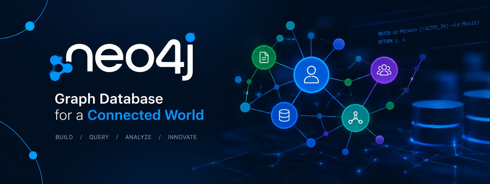
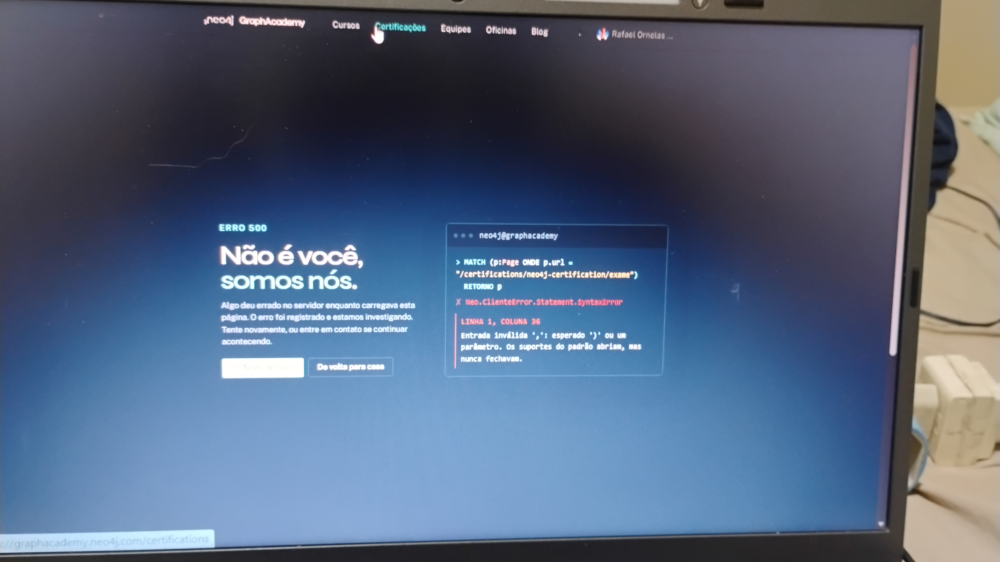

  <!-- Banner do Repositório -->
  

    

  <h1>📊 Case Study & Relatório de Certificação: Neo4j Certified Professional</h1>
  
<b>Desafio de Projeto DIO — Formação Graph Databases & Analytics</b>

  
Documentação técnica, engenharia de grafos e relatório de auditoria de plataforma.

   

  <!-- Badges Principais -->
  
  
  
  

    

  <!-- Selos de Qualidade e Segurança -->
  
  
  
  

 

---

## 📌 Sobre o Projetos e Objetivos

Este repositório documenta a jornada de preparação, resolução de modelos em grafos e a auditoria técnica da avaliação para a certificação **Neo4j Certified Professional**, vinculada aos programas da DIO.

O objetivo do projeto é consolidar conceitos fundamentais de bancos de dados orientados a grafos, linguagem de consulta **Cypher**, modelagem de nós/relacionamentos e aplicar governança técnica na gestão de evidências de exames e certidões.

---

## 🛠️ Tecnologias e Conceitos

* **Neo4j Graph Database:** Modelagem relacional baseada em grafos, propriedade de nós e arestas.
* **Cypher Query Language:** Consultas declarativas para navegação em grafos complexos.
* **GraphAcademy Platform:** Plataforma oficial de treinamento e exames da Neo4j.
* **Governança & QA:** Documentação padronizada e rastreabilidade de incidentes em exames técnicos.

---

## ⚠️ Registro de Diagnóstico de Indisponibilidade na Plataforma

Durante o processo de realização do exame oficial na plataforma **GraphAcademy**, foi identificada uma instabilidade crítica do lado do servidor (**Erro 500**), impedindo o envio e o processamento do gabarito da avaliação.

Como parte das boas práticas de **Garantia da Qualidade (QA)** e **Governança Técnica**, a falha foi devidamente registrada e documentada como um estudo de caso para transparência e validação da entrega acadêmica.

### Evidência Técnica do Erro (Captura de Tela):

  

### Detalhes do Incidente:
* **Mensagem da Plataforma:** *"Não é você, somos nós. Algo deu errado no servidor enquanto carregava esta página."*
* **Código de Erro:** `500 - Internal Server Error` / Syntax Error no endpoint do exame.
* **Ação Adotada:** Abertura deste repositório como dossiê comprobatório e validação de transparência profissional.

---

## 📬 Contatos

* 💼 **LinkedIn:** [rafaeltozato81](https://linkedin.com/in/rafaeltozato81)
* 🐙 **GitHub:** [Rafael-TOZATO](https://github.com/Rafael-TOZATO)
* ✍️ **Medium:** [@ornelas.tozato](https://medium.com/@ornelas.tozato)
* 🌐 **Dev Hub:** [tozato-dev-hub-app.vercel.app](https://tozato-dev-hub-app.vercel.app)
* 🌐 **H-Folio:** [h-folio-l0.vercel.app](https://h-folio-l0.vercel.app)
* 📜 **Microsoft Learn:** [Transcript](https://learn.microsoft.com/pt-br/users/rafaelornelastozato-2209/transcript/dzo2wizrkx2853)
